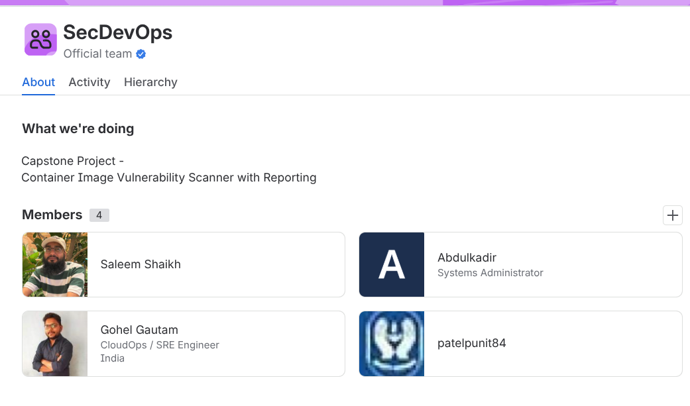
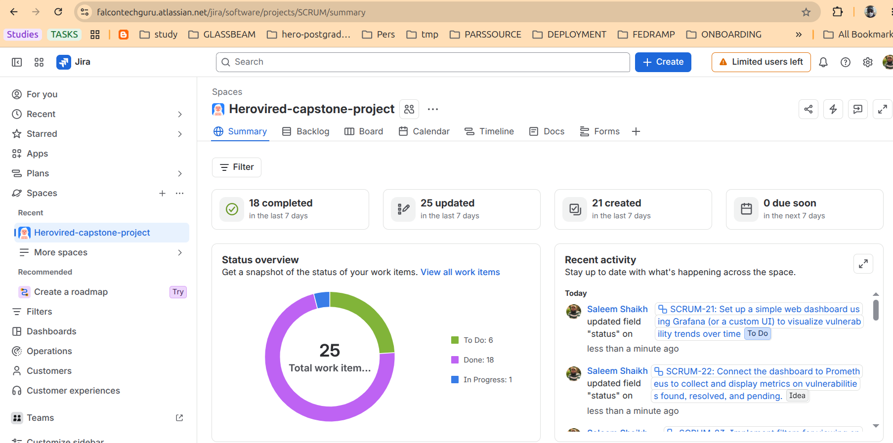
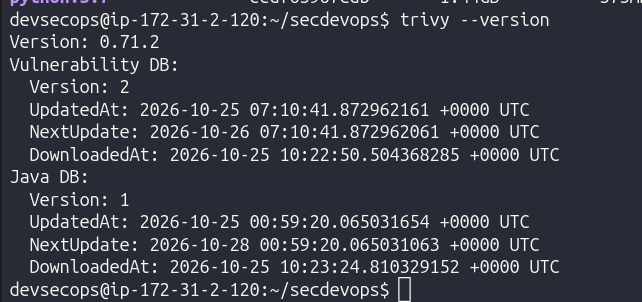
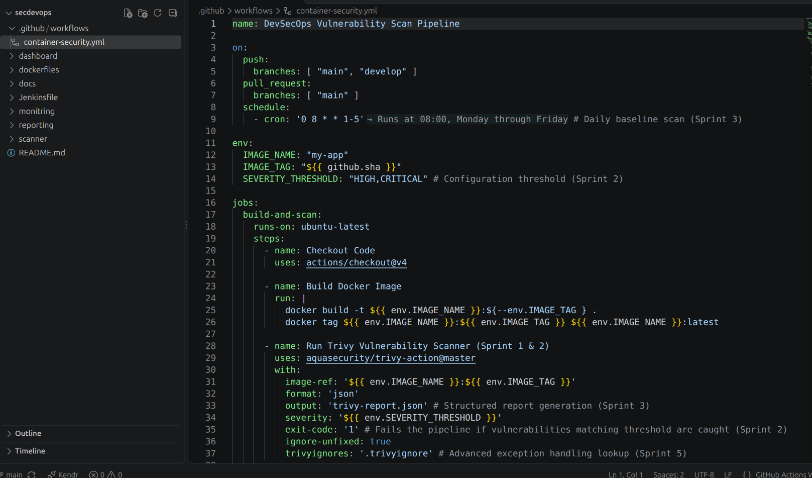
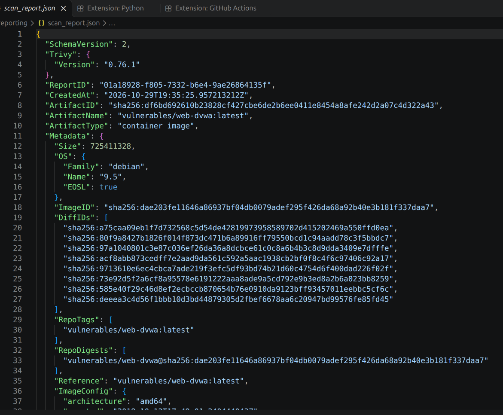
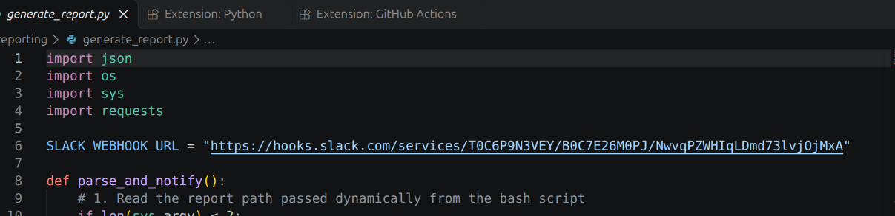

**Capstone Project**

**Container Image Vulnerability Scanner with Reporting**

**Assignment Name -** Container Image Vulnerability Scanner with Reporting

**Created by -** Gautam Gohel, Saleem Shaikh, Punit Patel, Abdulkadir Boxwala

**Batch - 16A**

**Date - Oct 31st, 2026**

**GIT Repo - [<u>https://github.com/saleeminfodevops/secdevops.git</u>](https://github.com/saleeminfodevops/secdevops.git)**

**Updated Document Link - [<u>https://docs.google.com/document/d/1EQq9ZQ6r5vhlbLKhOe246gi9TYp4PXvanYFe-uUuYBQ/edit?usp=sharing</u>](https://docs.google.com/document/d/1EQq9ZQ6r5vhlbLKhOe246gi9TYp4PXvanYFe-uUuYBQ/edit?usp=sharing)**

**<u>Tools Used</u>**

\- **Cloud:** AWS

\- **Programming Languages:** Python (for scripting and integrating CVE checks), Bash (for CI/CD pipeline integration)

\- **Vulnerability Database:** CVE database, Trivy to scan container images

\- **Alerting and Notification:** Slack API Hook For sending alerts and notifications

\- **CI/CD Integration**: GitHub Actions

**- Monitoring and Tracking**: Prometheus and Grafana for tracking vulnerability trends over time

\- **Containerization**: Docker to pull, build, and scan container images

**<u>Problem Statement</u>**

With the rise in containerized applications, securing container images is critical to prevent vulnerabilities from reaching production. However, DevOps teams often lack automated tools that integrate seamlessly into their CI/CD pipelines, resulting in manual checks or no checks at all. This project aims to develop an automated vulnerability scanner that scans container images for known vulnerabilities, integrates with CI/CD pipelines, and reports results, ensuring only secure images are deployed.

**Project Goals**

1\. Develop a vulnerability scanner that automatically scans container images before they are pushed to production, based on known vulnerability databases like the CVE database.

2\. Integrate the scanner into popular CI/CD pipelines (e.g., Jenkins, GitHub Actions) to ensure continuous security checks.

3\. Generate detailed vulnerability reports and send real-time notifications via Slack or Teams, allowing DevOps teams to take immediate action.

4\. Create a user-friendly dashboard that provides a historical view of vulnerabilities detected, resolved, and pending fixes.

**Project Sprints**

Each sprint has a 20-hour workload, organized into specific tasks for incremental progress.

**Sprint 1: Initial Setup and Basic Vulnerability Scanning**

\- Set up the project repository and define the folder structure.

[<u>https://github.com/saleeminfodevops/secdevops.git</u>](https://github.com/saleeminfodevops/secdevops.git)

\- Install and configure the Trivy vulnerability scanner to scan Docker images.

\- Pull a few sample images and perform initial vulnerability scans to understand output and logs.

\- Explore CVE database integration for real-time vulnerability checks.

\- **Goal Achieved:** Establish the foundation by setting up a basic image scanning process and verifying scanner output.

**Sprint 2: Integrating Vulnerability Scanning with CI/CD Pipelines**

\- Develop scripts to automate the scanning process for new container images in GitHub Actions.

\- Test CI/CD integration with sample images.

**Goal Achieved:** Ensure the vulnerability scanner works as part of the CI/CD pipeline, preventing builds from passing if vulnerabilities are detected.

**Sprint 3: Report Generation and Notification System**

\- Create a report generation module that organizes scan results in a structured format (PDF, HTML, or JSON).

\- Integrate with the Slack API to send scan summaries and alerts to designated channels.

**- Goal Achieved:** Develop a reporting and notification system that keeps the DevOps team informed of vulnerabilities.

**Sprint 4: Web Dashboard for Historical Vulnerability Tracking**

\- Set up a simple web dashboard using Grafana (or a custom UI) to visualize vulnerability trends over time.

\- Connect the dashboard to Prometheus to collect and display metrics on vulnerabilities found, resolved, and pending.

\- Implement filters for viewing specific images, date ranges, and vulnerability severity.

\- Test and refine the dashboard for usability and responsiveness.

\- Goal: Provide a user-friendly dashboard that tracks vulnerability history and allows for trend analysis.

**Sprint 5: Advanced Scanner Customization and Exception Handling**

\- Customize the scanner to skip certain vulnerabilities based on user-defined exceptions (e.g., approved known vulnerabilities).

\- Add functionality for rescanning images after a certain period or when vulnerabilities are patched.

\- Implement retry logic and error handling for CI/CD pipeline integration.

\- Test exception handling and ensure that users can manage and track known vulnerabilities.

\- Goal: Make the scanner more flexible, enabling exceptions for approved vulnerabilities and improving error handling.

**Sprint 6: Documentation, Testing, and Final Deployment**

\- Write comprehensive documentation for setup, usage, and troubleshooting.

\- Develop a deployment script for easy setup and configuration.

\- Perform extensive testing on different CI/CD systems GitHub Actions to ensure compatibility.

\- Gather feedback from beta users and make necessary adjustments.

\- Goal: Deliver a production-ready tool with clear documentation, extensive testing, and user feedback integration.

Summary of Deliverables by End of Project

\- Automated Vulnerability Scanner for container images

\- CI/CD Pipeline Integration with vulnerability thresholds and blocking mechanisms

\- Real-Time Notification System for Slack or Teams

\- Web Dashboard for tracking historical vulnerability data and trends

\- Comprehensive documentation covering setup, usage, and maintenance

1\. Develop a vulnerability scanner that automatically scans container images before they are pushed to production, based on known vulnerability databases like the CVE database. 2. Integrate the scanner into popular CI/CD pipelines (e.g., Jenkins, GitHub Actions) to ensure continuous security checks. 3. Generate detailed vulnerability reports and send real-time notifications via Slack or Teams, allowing DevOps teams to take immediate action. 4. Create a user-friendly dashboard that provides a historical view of vulnerabilities detected, resolved, and pending fixes.

Your requirements describe a complete **Container Vulnerability Management Platform** integrated into the DevSecOps lifecycle. Here's a proposed architecture and implementation plan.

# **Solution Overview**

## **Key Features**

### **1. Container Image Vulnerability Scanner**

Automatically scan Docker/OCI images before deployment using vulnerability databases such as:

- Trivy

- Grype

- National Vulnerability Database (NVD/CVE feeds)

- Clair

### **Scan Workflow**

Developer Commit

\|

v

CI/CD Pipeline

\|

v

Build Container Image

\|

v

Vulnerability Scan

\|

+--\> Critical/High Found -\> Fail Build

\|

+--\> Passed -\> Push to Registry

### **Example Trivy Scan**

trivy image \\

--severity HIGH,CRITICAL \\

--format json \\

-o report.json \\

myapp:latest

# **2. CI/CD Integration**

## **Jenkins Pipeline**

pipeline {

agent any

stages {

stage('Build Image') {

steps {

sh 'docker build -t myapp:\${BUILD_NUMBER} .'

}

}

stage('Security Scan') {

steps {

sh '''

trivy image \\

--severity HIGH,CRITICAL \\

--exit-code 1 \\

myapp:\${BUILD_NUMBER}

'''

}

}

stage('Push Image') {

steps {

sh 'docker push myapp:\${BUILD_NUMBER}'

}

}

}

}

## **GitHub Actions**

name: Container Security Scan

on:

push:

branches:

\- main

jobs:

scan:

runs-on: ubuntu-latest

steps:

\- uses: actions/checkout@v4

\- name: Build Image

run: docker build -t app:\${{ github.sha }} .

\- name: Scan Image

uses: aquasecurity/trivy-action@master

with:

image-ref: app:\${{ github.sha }}

severity: CRITICAL,HIGH

exit-code: '1'

# **3. Notification Engine**

## **Workflow**

Scan Completed

\|

+--\> Critical Found

\| \|

\| +--\> Slack Alert

\| +--\> Teams Alert

\|

+--\> Store Results

## **Slack Notification**

import requests

def send_slack(webhook_url, message):

payload = {

"text": message

}

requests.post(webhook_url, json=payload)

### **Sample Message**

🚨 Vulnerability Detected

Image: payment-service:1.2.4

Critical: 2

High: 8

Build Failed

View Report:

https://security.company.com/report/123

## **Microsoft Teams Notification**

import requests

def send_teams(webhook, message):

payload = {

"text": message

}

requests.post(webhook, json=payload)

# **4. Backend Architecture**

## **Recommended Technology Stack**

| **Component**     | **Technology**      |
|-------------------|---------------------|
| API               | Python FastAPI      |
| Scanner Engine    | Trivy / Grype       |
| Database          | PostgreSQL          |
| Message Queue     | RabbitMQ / Kafka    |
| Dashboard         | React               |
| Authentication    | OAuth2 / SSO        |
| Container Runtime | Docker / Kubernetes |
| Reporting         | PDF & CSV           |

# **Database Schema**

## **Images**

CREATE TABLE images (

id SERIAL PRIMARY KEY,

image_name VARCHAR(255),

image_tag VARCHAR(100),

scan_date TIMESTAMP

);

## **Vulnerabilities**

CREATE TABLE vulnerabilities (

id SERIAL PRIMARY KEY,

image_id INT,

cve_id VARCHAR(50),

severity VARCHAR(20),

package_name VARCHAR(255),

installed_version VARCHAR(100),

fixed_version VARCHAR(100),

status VARCHAR(20)

);

## **Scan History**

CREATE TABLE scan_history (

id SERIAL PRIMARY KEY,

image_id INT,

critical_count INT,

high_count INT,

medium_count INT,

low_count INT,

scan_time TIMESTAMP

);

# **Dashboard Features**

## **Executive View**

- Total images scanned

- Critical vulnerabilities

- High vulnerabilities

- Resolved vulnerabilities

- Pending remediation

- Compliance score

## **Historical Trends**

Month Critical High

--------------------------------

Jan 120 450

Feb 85 320

Mar 40 190

Apr 18 90

## **Visualizations**

- Vulnerability trends

- Severity distribution

- Top vulnerable repositories

- Mean time to remediation (MTTR)

- CVE aging analysis

# **Kubernetes Admission Control (Optional)**

Prevent deployment of vulnerable images.

### **Policy Example**

apiVersion: kyverno.io/v1

kind: ClusterPolicy

metadata:

name: block-critical-images

spec:

validationFailureAction: Enforce

rules:

\- name: block-critical

match:

resources:

kinds:

\- Pod

validate:

message: "Critical vulnerabilities detected"

deny:

conditions:

all:

\- key: "{{ request.object.metadata.labels.scan-status }}"

operator: Equals

value: "failed"

# **End-to-End Architecture**

+----------------+

\| GitHub/Jenkins \|

+--------+-------+

\|

v

+----------------+

\| Image Build \|

+--------+-------+

\|

v

+----------------+

\| Trivy/Grype \|

+--------+-------+

\|

+----------------+----------------+

\| \|

v v

+----------------+ +----------------+

\| PostgreSQL \| \| Slack/Teams \|

\| Scan Results \| \| Notifications \|

+----------------+ +----------------+

\|

v

+-----------------------+

\| FastAPI Backend \|

+-----------------------+

\|

v

+-----------------------+

\| React Dashboard \|

+-----------------------+

### **Expected Outcome**

- Automatic image scanning before production deployment.

- CI/CD pipeline enforcement with build failure on critical findings.

- Real-time Slack/Teams alerts.

- Centralized vulnerability dashboard with historical tracking.

- Compliance-ready reporting and audit trail.

- Optional Kubernetes admission control to block risky deployments.
