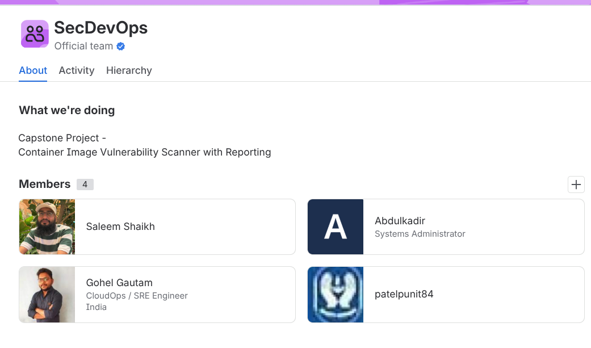
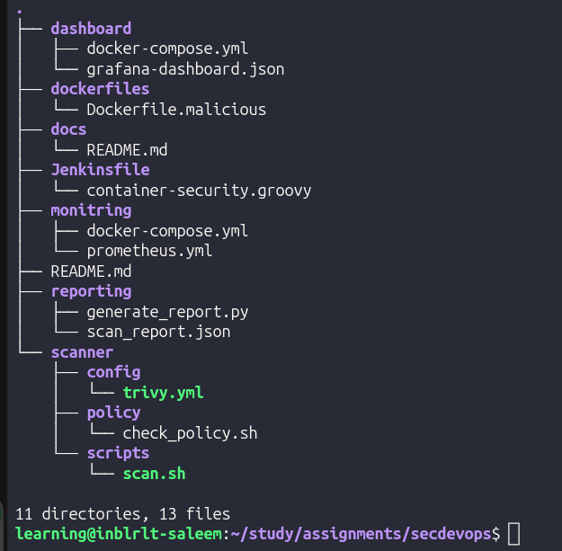
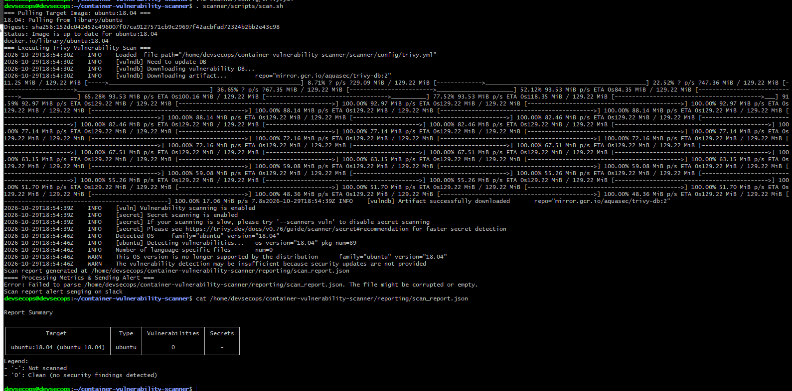
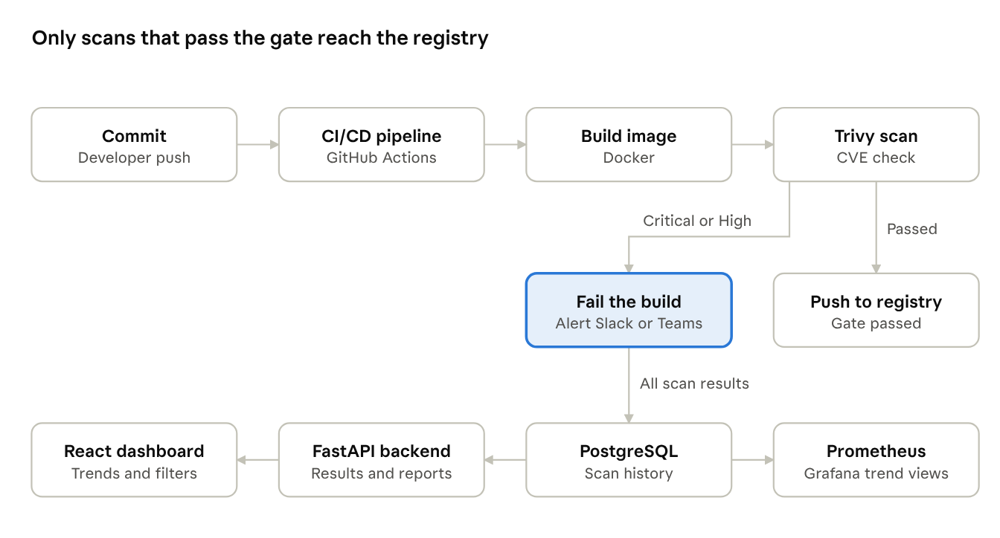
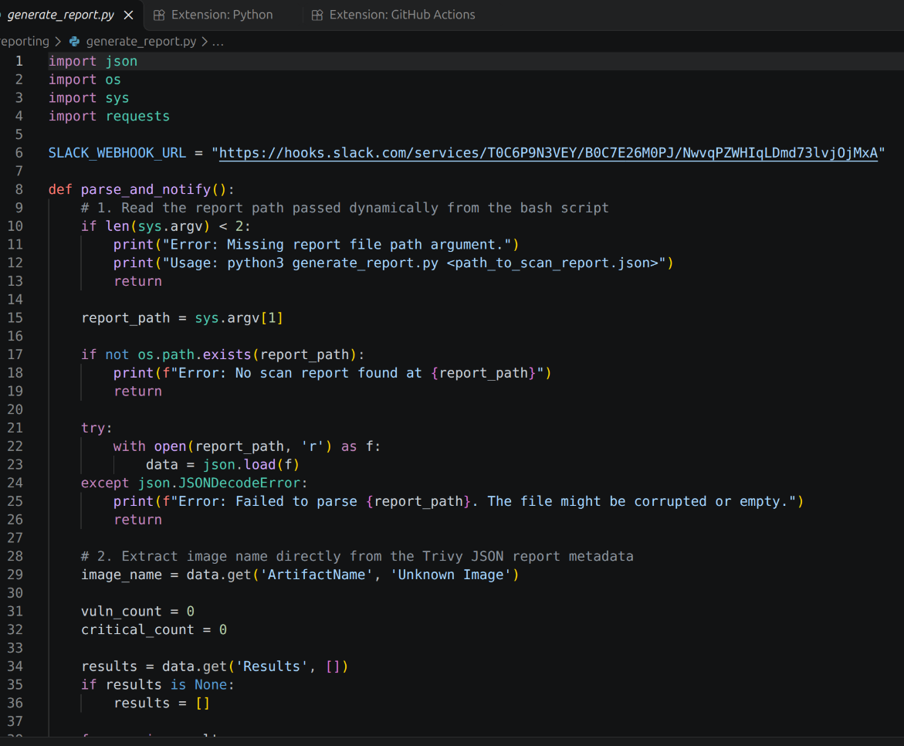
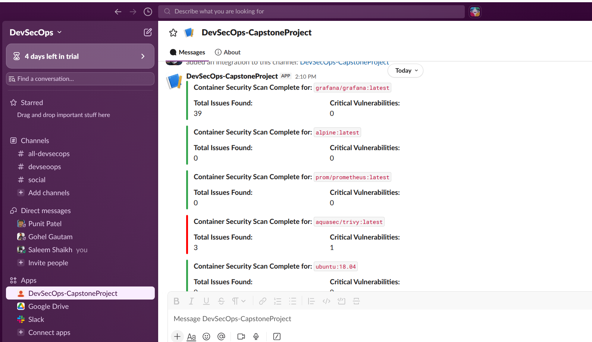
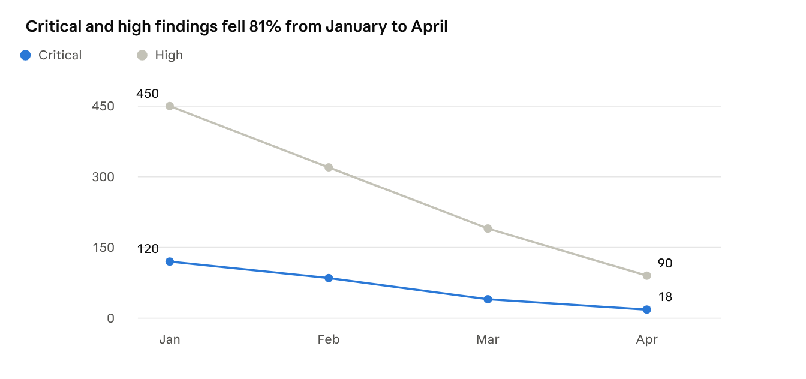

# Container Image Vulnerability Scanner with Reporting

Nov 23, 2026 · @Saleem Shaikh

An automated scanner that checks container images for known CVEs before they reach production, gates CI/CD builds, and reports results to Slack or Teams.

## Project facts

| Item | Detail |
|----|----|
| Batch | 16A |
| Submission date | Oct 31, 2026 |
| Team | Gautam Gohel, Saleem Shaikh, Punit Patel, Abdulkadir Boxwala |
| Source repository | [github.com/saleeminfodevops/secdevops](https://github.com/saleeminfodevops/secdevops.git) |
| Updated document | [Google Doc](https://docs.google.com/document/d/1EQq9ZQ6r5vhlbLKhOe246gi9TYp4PXvanYFe-uUuYBQ/edit?usp=sharing) |

*Figure 1. The SecDevOps team page on GitHub, with the four members and the capstone description.*

## Problem and goals

DevOps teams often lack image scanning that fits their CI/CD pipelines, so known vulnerabilities reach production. This project builds an automated scanner that checks images against known-vulnerability databases, integrates with pipelines, and reports results.

### Problem statement

Containerized applications need secure images before deployment. Today checks are manual or skipped, so teams cannot be sure that only secure images ship.

### Goals

1.  Scan container images automatically before they are pushed to production, using vulnerability databases such as the CVE database.
2.  Integrate the scanner into CI/CD pipelines (Jenkins, GitHub Actions) for continuous security checks.
3.  Generate detailed vulnerability reports and send real-time alerts to Slack or Teams.
4.  Provide a dashboard with a historical view of vulnerabilities detected, resolved and pending fixes.

## Technology stack

The project uses AWS as the cloud platform, Trivy for scanning, and GitHub Actions for CI/CD. The stack below covers the scanner, pipelines, alerts, storage and dashboard.

| Component | Technology | Purpose |
|----|----|----|
| Cloud | AWS | Hosting for the scanner and supporting services |
| Containerization | Docker | Pull, build and scan container images |
| Scanner | Trivy (Grype as an alternative) | Scan images against CVE data |
| Vulnerability data | CVE database, NVD feeds | Source of known vulnerabilities |
| CI/CD | GitHub Actions (Jenkins supported) | Run scans on every build |
| Scripting | Python, Bash | CVE checks, pipeline integration |
| Alerting | Slack API (Microsoft Teams webhook) | Send scan summaries and alerts |
| API | Python FastAPI | Serve scan results and reports |
| Storage | PostgreSQL | Store images, vulnerabilities and scan history |
| Monitoring | Prometheus and Grafana | Track vulnerability trends over time |
| Dashboard | React (or Grafana) | Historical view and filters |
| Authentication | OAuth2 / SSO | Access control for the dashboard and API |

## Project sprints

Six sprints of 20 hours each build the scanner in stages, from a basic scan to a production-ready tool.

| Sprint | Focus | Key tasks | Outcome |
|----|----|----|----|
| 1 | Initial setup and basic scanning | Set up the repository and folder structure; install Trivy; scan sample images; explore CVE integration | Working image scanning with verified output |
| 2 | CI/CD integration | Automate scans of new images in GitHub Actions; test with sample images | Builds fail when vulnerabilities are detected |
| 3 | Reports and notifications | Build a report module (PDF, HTML or JSON); integrate the Slack API for summaries and alerts | Structured reports and team notifications |
| 4 | Web dashboard | Build a dashboard in Grafana or a custom UI; connect to Prometheus; add filters by image, date and severity | Historical tracking of found, resolved and pending issues |
| 5 | Customization and exceptions | Skip approved vulnerabilities; rescan after a period or patch; add retry and error handling | Flexible scanner with managed exceptions |
| 6 | Documentation and deployment | Write setup and usage docs; build a deployment script; test on GitHub Actions; gather beta feedback | Production-ready tool with documentation |

### Sprint tracking in Jira

*Figure 2. The Jira backlog. Sprints 1, 2, 3, 5 and 6 are Done; the dashboard work in Sprint 4 is In Progress.*

*Figure 3. The Jira project summary: 18 items completed and 25 updated in the last seven days.*

### Sprint 1 evidence: repository and scanner setup

*Figure 4. The secdevops repository, with folders for the scanner, reporting, dashboard, monitoring and CI files.*

*Figure 5. Cloning the repository.*

*Figure 6. The folder structure: scanner, reporting, dashboard, monitoring, docs, and Jenkinsfile and workflow files.*

*Figure 7. Trivy 0.71.2, with the vulnerability database update status.*

*Figure 8. The first Trivy scan of ubuntu/nginx:latest (Ubuntu 25.04). It reports one HIGH finding, CVE-2025-68973 in gpgv, with status fixed.*

## Solution architecture

scan and reporting flow · 9 steps, 1 gate

Every image is scanned in the pipeline. A critical or high finding fails the build and alerts the team, and all results are stored for the dashboard.

## CI/CD integration

The scan runs as a pipeline stage after the image build and before the push. A critical or high finding fails the build, so the image never reaches the registry.

1.  Developer commits code.
2.  The pipeline builds the container image.
3.  Trivy scans the image for HIGH and CRITICAL vulnerabilities.
4.  Critical or high findings fail the build and trigger an alert.
5.  A clean scan pushes the image to the registry.

### Example Trivy scan

trivy image \\  
--severity HIGH,CRITICAL \\  
--format json \\  
-o report.json \\  
myapp:latest

### Jenkins pipeline

pipeline {  
agent any  
stages {  
stage('Build Image') {  
steps { sh 'docker build -t myapp:\${BUILD_NUMBER} .' }  
}  
stage('Security Scan') {  
steps {  
sh '''  
trivy image \\  
--severity HIGH,CRITICAL \\  
--exit-code 1 \\  
myapp:\${BUILD_NUMBER}  
'''  
}  
}  
stage('Push Image') {  
steps { sh 'docker push myapp:\${BUILD_NUMBER}' }  
}  
}  
}

### GitHub Actions workflow

name: Container Security Scan  
on:  
push:  
branches: \[main\]  
jobs:  
scan:  
runs-on: ubuntu-latest  
steps:  
- uses: actions/checkout@v4  
- name: Build image  
run: docker build -t app:\${{ github.sha }} .  
- name: Scan image  
uses: aquasecurity/trivy-action@0.28.0  
with:  
image-ref: app:\${{ github.sha }}  
severity: CRITICAL,HIGH  
exit-code: '1'

*Figure 9. The workflow file in the repository. It still uses trivy-action@master, which the pinning note below recommends replacing.*

Pin the scanner action to a released version tag, as above, rather than @master. An unpinned action can change without notice and alter the gate.

*Figure 10. A local scan run on ubuntu:18.04. It reports 0 vulnerabilities, but the log also shows a failed-to-parse error when the alert is generated. That step needs a fix.*

## Notifications

Every completed scan stores its results. A scan with critical findings also sends an alert to Slack, Teams or both.

1.  Scan completes.
2.  If critical or high findings exist, send an alert to Slack and Teams.
3.  Store the results for the dashboard in every case.

### Slack notification

import requests  
def send_slack(webhook_url, message):  
resp = requests.post(webhook_url, json={"text": message}, timeout=10)  
resp.raise_for_status()

### Microsoft Teams notification

import requests  
  
def send_teams(webhook_url, message):  
resp = requests.post(webhook_url, json={"text": message}, timeout=10)  
resp.raise_for_status()

The timeout and status check keep a slow or failing webhook from hanging the pipeline or passing silently.

### Sample alert

Vulnerability detected  
Image: payment-service:1.2.4  
Critical: 2  
High: 8  
Build failed  
View report: https://security.company.com/report/123

### Sprint 3 evidence: Slack alerts and report files

*Figure 11. Slack alerts from the DevSecOps-CapstoneProject app for five images. Trivy reports 3 issues, one of them critical.*

### Report generation

The reporting script reads the Trivy JSON file and sends the summary to Slack. The Slack webhook URL should not be kept in source code. Move it to a CI secret and rotate it, because the URL in this file was exposed. The URLs are redacted in the screenshots below.

*Figure 12. The start of generate_report.py. The webhook line is redacted.*

*Figure 13. generate_report.py takes the report path as an argument and parses the Trivy JSON. The webhook line is redacted.*

*Figure 14. A Trivy JSON report (SchemaVersion 2) for vulnerables/web-dvwa:latest, the input to the reporting script.*

## Data model

Three PostgreSQL tables hold each image, its findings and its scan history. The schema below adds foreign keys and NOT NULL constraints to the original draft.

| Table | Holds | Key columns |
|----|----|----|
| images | One row per scanned image | image_name, image_tag, scan_date |
| vulnerabilities | One row per CVE found in an image | cve_id, severity, package_name, fixed_version, status |
| scan_history | Severity counts per scan, for trends | critical_count, high_count, medium_count, low_count |

CREATE TABLE images (  
id SERIAL PRIMARY KEY,  
image_name VARCHAR(255) NOT NULL,  
image_tag VARCHAR(100) NOT NULL,  
scan_date TIMESTAMP NOT NULL  
);  
  
CREATE TABLE vulnerabilities (  
id SERIAL PRIMARY KEY,  
image_id INT NOT NULL REFERENCES images(id),  
cve_id VARCHAR(50) NOT NULL,  
severity VARCHAR(20) NOT NULL,  
package_name VARCHAR(255),  
installed_version VARCHAR(100),  
fixed_version VARCHAR(100),  
status VARCHAR(20) NOT NULL  
);  
  
CREATE TABLE scan_history (  
id SERIAL PRIMARY KEY,  
image_id INT NOT NULL REFERENCES images(id),  
critical_count INT NOT NULL DEFAULT 0,  
high_count INT NOT NULL DEFAULT 0,  
medium_count INT NOT NULL DEFAULT 0,  
low_count INT NOT NULL DEFAULT 0,  
scan_time TIMESTAMP NOT NULL  
);

## Dashboard

The dashboard tracks the vulnerability history so teams can see whether critical and high findings are falling.

### Executive view

- Total images scanned
- Critical vulnerabilities
- High vulnerabilities
- Resolved vulnerabilities
- Pending remediation
- Compliance score

### Historical trend

sample figures from the original brief · monthly counts, Jan to Apr

The figures above are sample data from the original brief, not live scan results.

### Planned visualizations

- Vulnerability trends over time
- Severity distribution
- Top vulnerable repositories
- Mean time to remediation (MTTR)
- CVE aging analysis

## Deliverables and expected outcomes

The project delivers five components by the end of Sprint 6. Together they block vulnerable images in the pipeline and track their history.

### Deliverables

1.  Automated vulnerability scanner for container images.
2.  CI/CD pipeline integration with vulnerability thresholds and blocking.
3.  Real-time Slack or Teams notification system.
4.  Web dashboard for historical vulnerability data and trends.
5.  Documentation covering setup, usage and maintenance.

### Expected outcomes

- Images are scanned automatically before production deployment.
- Pipelines fail the build on critical findings.
- Slack or Teams receives real-time alerts.
- A central dashboard tracks vulnerability history.
- Scan results form a compliance-ready audit trail.

deny:  
conditions:  
all:  
- key: '{{ request.object.metadata.labels."scan-status" }}'  
operator: Equals  
value: "failed"
